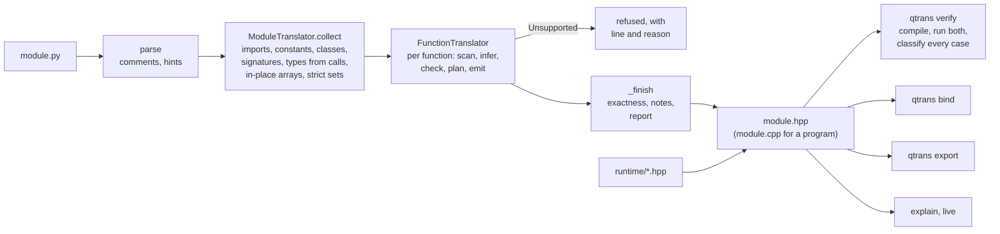

# How qtrans is built

How a Python file becomes C++, where each guarantee of [the specification](SPEC.md) is kept,
and how the result is checked. File names are under `qtrans/`.

## 1. A module (`translator.py`, `project.py`)

`ModuleTranslator` reads one file. `collect()` does everything that needs the whole file before any
function can be written:

1. **Parse**, and keep the comments (Python's AST drops them; `tokenize` keeps them, so they can
   be carried into the C++) and the `# qtrans:` hints (`hints.py`).
2. **Imports, constants, classes.** Imports from the scientific stack are resolved to qualified
   names (`np.exp` → `numpy.exp`); imports from other files of the project come from their
   already-translated modules (`project.py` translates in dependency order). Classes become
   `ClassInfo` (`classes.py`): fields, methods, the base, whether objects are shared
   (`std::shared_ptr`, for a hierarchy).
3. **Signatures.** From the annotations, or, where they are left out, from how the file calls
   the function (`_infer_from_calls`; one C++ version per kind of call where calls differ).
4. **Whole-file facts** the functions depend on: which functions change an array argument in
   place (so it is taken by reference: `analyze_array_params`), which change an object of a
   hierarchy (`_find_object_mutators`), which print (`_find_printing`), which use the random
   module (`_find_py_random_users`), and which raise Python's float errors (`_find_strict`: all
   of them since 1.0, except those marked `# qtrans: ieee`; and the ones a `try` may catch an error
   in, where the hint is ignored).

Then each function is translated (section 2). A function that raises `Unsupported` anywhere is
refused, and so, by a fixpoint, is every function that calls it. `_finish` computes what needs
every body: which functions raise Python's float errors exactly, transitively over what they call
(`_exact_float_errors`, which `verify` uses), the report's notes, and the header with exactly the
`#include`s its code uses.

## 2. A function (`functions.py`)

`FunctionTranslator.translate()` runs, in order:

| Pass | What it does |
|---|---|
| scan | refuse unsupported statements; record every assignment |
| loop variables | a `for` variable is used only inside its loop |
| infer types | one C++ type per local, a fixpoint over the assignments (`int` < `float`; two subclasses join to their base) |
| infer sizes | a size token per array dimension, so `a - b` needs no broadcasting check where the sizes are provably equal |
| aliasing | two names for one array, list or object where one is then changed: refused where C++ would copy and Python shares |
| lists, random draws | changing a list passed in; two draws in one statement (C++ evaluation order) |
| int or float | a variable Python shows as an int on some runs and a float on others gets a flag |
| declarations | where each variable is declared (the innermost block that covers its uses) |
| definite assignment | a read that may find a local unset (`unbound.py`): a flag, and Python's UnboundLocalError |
| returns | every path of a function returning a value ends in `return` or `raise` |
| emit | the C++ statements, comments carried across; statements that are one left-first temporary become two lines |

Expressions are translated by `ExprTranslator` (`expressions.py`), mixed into the function
translator with the specialised parts: `arrays.py` and `intarrays.py` (NumPy on Eigen),
`lists.py`, `dicts.py`, `strings.py`, `printing.py` (Python's text, exactly), `structs.py`
(objects). Each returns an `Expr`: the C++ code, its precedence, its type, and what is known
about it (an int's range, an array's sizes), so later decisions can use it: a divisor known not
to be 0 needs no check, an int sum known to fit in 64 bits needs no overflow check.

## 3. Where each guarantee is kept

| Guarantee (SPEC section) | Where |
|---|---|
| Python's operators on numbers: `//`, `%`, `round`, int overflow (4.1, 4.2) | `expressions.py` chooses; `runtime/qtrans_runtime.hpp` implements (`qt::floordiv`, `qt::iadd`, ...) |
| Python's float errors (4.2) | `translator._find_strict` decides which code raises them; `expressions._python_raises` decides each operation; `runtime/qtrans_print.hpp` (`qt::py::truediv`, `math_*`, `power`) raises them, the throw in a cold function |
| A Python float or a NumPy number (4.2, 5) | `origins.py`: where each value comes from (NumPy's numbers don't raise, and repr as `np.float64(...)`) |
| The running Python's messages (2, 9) | `pyfacts.py` makes each error happen in the running Python and writes `qtrans_python.hpp` (cached per version, checked against what the runtime uses) |
| Evaluation order (4.3) | `expressions.left_first`, `in_python_order`, `with_receiver`; `functions.emit` (the temporaries as statements); what may raise is read from each function's own C++ (`translator.code_may_raise`) |
| Sharing (1.4, 6, 8, 10) | `functions.check_aliasing`, `translator.analyze_array_params`; objects of a hierarchy as `std::shared_ptr` |
| Unset variables (3) | `unbound.py` (definite assignment as Python runs the code); `qt::py::bound` |
| Printing (5) | `printing.py`; `runtime/qtrans_print.hpp` (shortest repr, the format mini-language, NumPy's array printing) |
| NumPy's algorithms (10) | `runtime/qtrans_arrays.hpp`: pairwise summation, `var`, `quantile`, `linspace`, broadcasting, views |
| Random numbers (11) | `runtime/qtrans_random.hpp` (SeedSequence, PCG64, NumPy's conversions), `runtime/qtrans_pyrandom.hpp` (CPython's Mersenne Twister, `Lib/random.py`) |
| Unicode (5) | `unicode_tables.py` writes `qtrans_unicode.hpp` from the running Python |
| Refusals (all) | `errors.Unsupported`, raised where the problem is seen, with the line and a hint |

## 4. The runtime (`runtime/`)

Header-only C++17, copied next to the generated headers. Each helper exists because C++ and
Python disagree on something.

| Header | What it holds |
|---|---|
| `qtrans_runtime.hpp` | Python's exception classes; `//`, `%`, checked int arithmetic, `round`, `qt::pow`; the normal distribution |
| `qtrans_python.hpp` | the running Python's error messages and math-error rules (generated) |
| `qtrans_print.hpp` | text as Python and NumPy write it; Python's float errors |
| `qtrans_list.hpp` | lists and dicts with Python's rules (negative indexes, KeyError, insertion order), str methods |
| `qtrans_arrays.hpp` | NumPy on Eigen: broadcasting, views, reductions, linear algebra, int64 arrays |
| `qtrans_random.hpp`, `qtrans_pyrandom.hpp` | NumPy's generator and Python's random module, number for number |
| `qtrans_unicode.hpp` | Unicode tables for str methods (generated) |
| `qtrans_pybind.hpp` | what the bindings need: conversions, write-backs, exceptions |

## 5. Checking (`verify.py`, `tools/fuzz/`)

`qtrans verify` writes a C++ driver that calls every translated function by name on inputs read
from stdin, compiles it with the header (warnings on, no fast-math, contraction off), and feeds
the same cases to Python and to the driver: the file's `QTRANS_CASES` and random ones (arrays of
mixed and empty shapes, extreme values, objects of every concrete class, generators seeded the
same way). Values travel as hex floats, so nothing is rounded on the way. Each case is
classified (`classify`): match, ill-conditioned (within 100× of how far Python's own answer moves
under a 4-ULP nudge of the inputs), known (a documented difference, only where it can apply: not
"Python raised and the C++ didn't" in a function that raises Python's errors), edge (linear
algebra on inf / NaN), or mismatch. A program is also run both ways, its output compared
character for character.

The program fuzzer (`tools/fuzz/`: `gen.py` writes random typed programs in the subset,
`check.py` translates and verifies them, `shrink.py` cuts a failing one down to a minimal
reproducer) runs on every push with a fixed seed, and by hand with new seeds.

## 6. Tests

| Layer | What it checks |
|---|---|
| text tests (`test_translation.py`, ...) | the C++ reads as written by hand, and refusals give their reasons |
| compiled tests (`test_semantics.py`, `test_exceptions.py`, probes in `tests/data/`) | the runtime against Python and NumPy on thousands of values each (22,957 for the error messages) |
| examples (`test_examples.py`, `run_examples.py --check`) | 11 modules verified; every count in `examples/RESULTS.md` and every generated file reproduces |
| the specification (`test_spec.py`) | each example in `docs/SPEC.md` translates as quoted, is refused as quoted, or runs as Python does |
| bindings, export, projects, live | each tool end to end |
| CI | Linux GCC and Clang at -O0 / -O2 / -O3 and with sanitizers, Python 3.10 to 3.14, Windows (MinGW, MSVC), macOS ARM; the fuzzer |

## 7. Adding a construct

1. Where it is seen (a statement in `functions.py`, an expression in `expressions.py` or its
   specialised parts), translate it, or raise `Unsupported` with the reason and a hint.
2. If Python's rule differs from C++'s, the rule goes in the runtime, with a probe test against
   Python on many values.
3. A text test for how the C++ reads, a compiled test for what it computes, and an example in
   `docs/SPEC.md` (`spec translated` / `spec refused` / `spec program`).
4. `run_examples.py` and `run_examples.py --check`; the full suite with GCC and Clang; the fuzzer.
